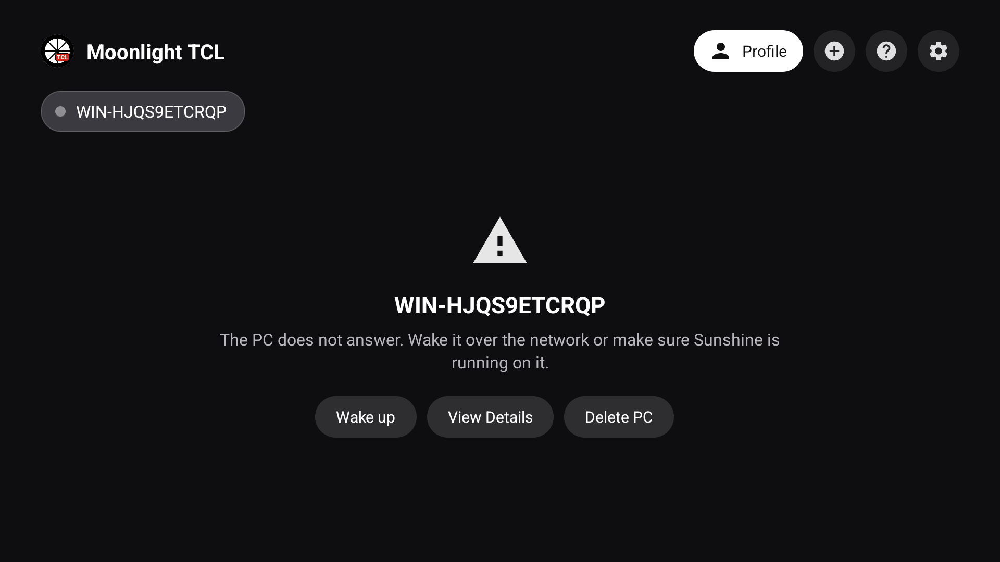
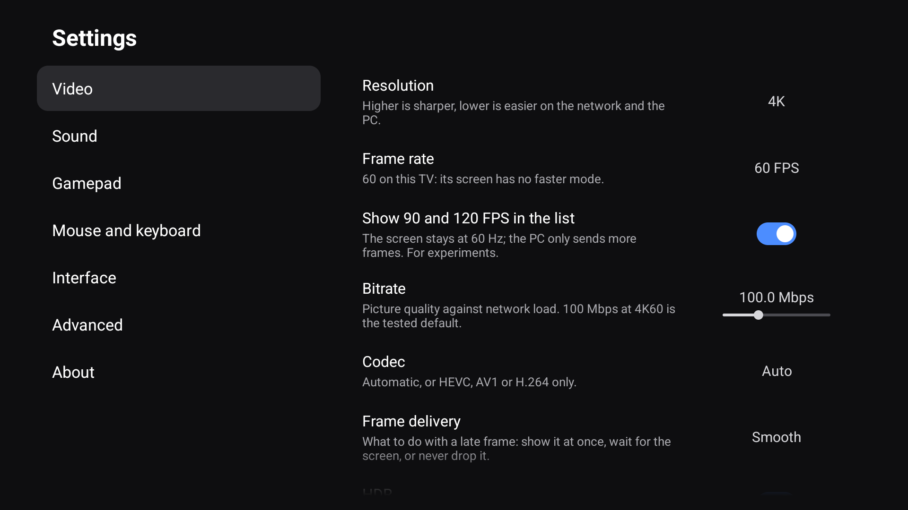
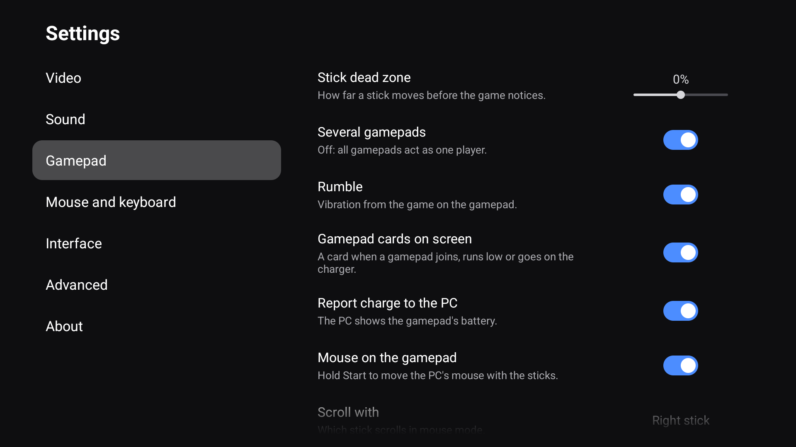
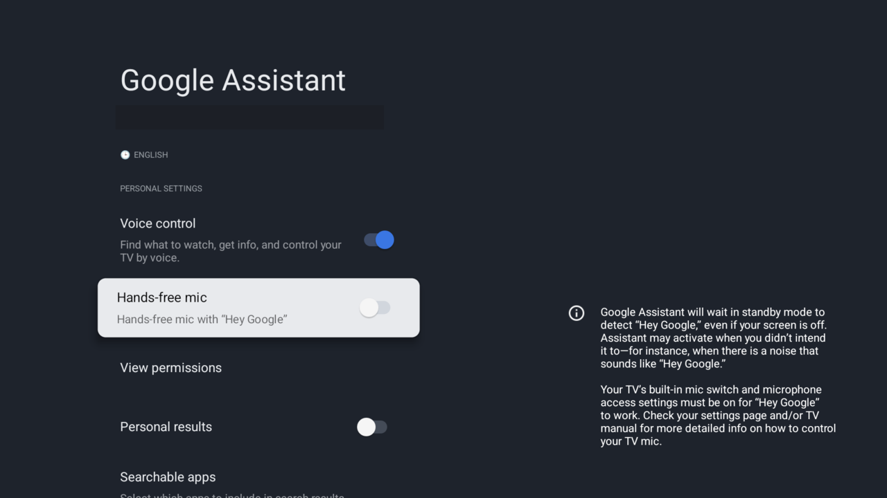
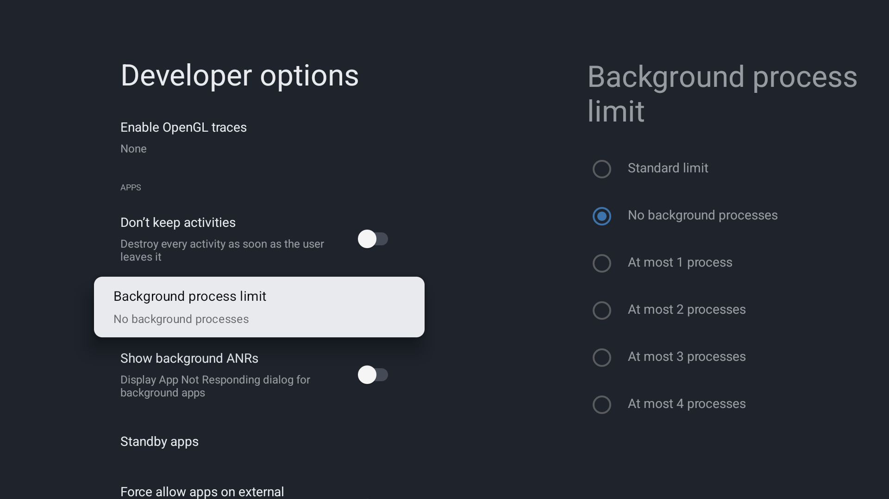

<p align="center"></p>

<h1 align="center">Moonlight TCL</h1>

<p align="center"><b>Moonlight для телевизоров TCL на Google TV с Android 14.</b><br>
Без зависаний, без перезагрузок, без унаследованных крашей и с минимальной задержкой, которую может дать чип MediaTek:<br>
4K HDR ровно в 60 кадров в секунду, посчитанных на экране.</p>

<p align="center"><a href="README.md">English</a> · <b>Русский</b></p>

<p align="center">
  <a href="https://github.com/pabragin/moonlight-tcl/releases/latest"></a>
  <a href="https://github.com/pabragin/moonlight-tcl/releases/latest"></a>
  <a href="#как-запустить"></a>
  <a href="LICENSE.txt"></a>
</p>

<p align="center">
  <a href="https://github.com/pabragin/moonlight-tcl/releases/latest"></a>&nbsp;
  <a href="https://apps.obtainium.imranr.dev/redirect?r=obtainium://app/%7B%22id%22%3A%22com.limelight.tcl%22%2C%22url%22%3A%22https%3A%2F%2Fgithub.com%2Fpabragin%2Fmoonlight-tcl%22%2C%22author%22%3A%22pabragin%22%2C%22name%22%3A%22Moonlight%20TCL%22%2C%22additionalSettings%22%3A%22%7B%5C%22apkFilterRegEx%5C%22%3A%5C%22armeabi-v7a%5C%22%2C%5C%22matchGroupToUse%5C%22%3A%5C%22%241%5C%22%2C%5C%22versionExtractionRegEx%5C%22%3A%5C%22v(.%2B)%5C%22%7D%22%7D"></a>&nbsp;
  <a href="https://github.com/pabragin/moonlight-tcl/releases"></a>
</p>

<p align="center">
  <a href="#почему-эта-сборка">Зачем</a> ·
  <a href="#как-запустить">Установка</a> ·
  <a href="#измерено-а-не-обещано">Цифры</a> ·
  <a href="#что-внутри">Возможности</a> ·
  <a href="#настройка-телевизора">Настройка ТВ</a> ·
  <a href="#запуск-стрима-из-home-assistant">Home Assistant</a> ·
  <a href="#сборка">Сборка</a>
</p>

Сборка [Artemis](https://github.com/ClassicOldSong/moonlight-android), форка Moonlight для Android, настроенная под чип MediaTek
в **телевизорах TCL на Google TV с прошивкой Android 14** (C8K, C6K, QM6K, QM8K и похожие). Стримит игры и рабочий стол с
[Sunshine](https://github.com/LizardByte/Sunshine) или [Apollo](https://github.com/ClassicOldSong/Apollo) на ПК. Ставится как
отдельное приложение (`com.limelight.tcl`) рядом с Artemis или Moonlight, поэтому их обновления его не затирают; настройки и пары
с ПК у каждого приложения свои. Только Android 14 и `armeabi-v7a`, потому что на этих телевизорах другого нет. Все цифры здесь
сняты на TCL C8K. Предыстория: [moonlight-stream/moonlight-android#1533](https://github.com/moonlight-stream/moonlight-android/issues/1533).

<table>
<tr>
<td width="34%"></td>
<td width="33%"></td>
<td width="33%"></td>
</tr>
</table>

## Почему эта сборка

<table>
<tr>
<td width="50%" valign="top">
<h3>🛡️ Телевизор не зависает и не перезагружается</h3>
В прошивке TCL на Android 14 у службы ввода есть гонка, которую запускает вибрация геймпада: служба падает, телевизор показывает
анимацию загрузки, и все приложения перезапускаются. Moonlight TCL отправляет вибрацию через Bluetooth-стек, поэтому геймпад
вибрирует, а телевизор продолжает работать. Зависания всего телевизора при выходе из стрима или при меню поверх видео идут от
старых прошивок TCL; на них Moonlight TCL по умолчанию держит над видео второй слой, и зависаний нет. Симптом «через час меняешь
громкость, и экран гаснет» был тем же падением из-за вибрации.
</td>
<td width="50%" valign="top">
<h3>🐛 Унаследованные краши исправлены</h3>
Экран настроек, который в Artemis падал при открытии, падение на слишком больших кадрах при высоком битрейте и обработка потерь,
из-за которой один потерянный пакет мог отбросить 120 кадров подряд (три исправления из апстримного moonlight-common-c), больше
не мешают. Убраны и настройки, которые на телевизоре ничего не могли изменить: 45 настроек в семи категориях вместо 85 в десяти.
</td>
</tr>
<tr>
<td width="50%" valign="top">
<h3>⚡ Кратчайший путь до панели</h3>
Декодированные кадры уходят на экран прямо из колбэка декодера: без потока отрисовки, без блокирующих ожиданий, каждый кадр
копируется один раз. Звук идёт через нативный AAudio. Потоки видео работают с приоритетом экрана и подсказками производительности
Android, а видео остаётся единственным слоем на экране, так что композитор идёт быстрым путём. Собственная доля клиента во времени
декодирования кадра меньше миллисекунды, остальное аппаратный декодер MediaTek.
</td>
<td width="50%" valign="top">
<h3>🎞️ Каждый кадр доходит до экрана</h3>
Тот же телевизор, тот же стрим 4K60 HDR на 100 Мбит/с, подсчёт на композиторе телевизора: у официального Artemis 20.2.6 все
60 кадров дошли до экрана в <b>0 из 48</b> замеров, у Moonlight TCL в <b>44 из 48</b>, при загрузке процессора на треть меньше.
Оба получают одни и те же 60 кадров и декодируют их за одно и то же время; разница в пути от декодера до экрана.
</td>
</tr>
<tr>
<td width="50%" valign="top">
<h3>🪶 Ничего между вами и стримом</h3>
APK 2,1 МБ со всеми языками и 32 МБ памяти на главном экране (у Artemis 20.2.6 на том же телевизоре 12 МБ и 81 МБ).
Без AndroidX, Material и OkHttp: все экраны построены на виджетах самой системы и собственных View приложения, хост опрашивается
через <code>HttpsURLConnection</code>, а большая часть размера это нативная библиотека декодера и стриминга.
Один экран перед стримом, настройки переключаются на месте, ждать нечего.
</td>
<td width="50%" valign="top">
<h3>🎮 Сделано для телевизора и геймпада</h3>
ПК чипами, приложения постерами, тёмная панель действий по Menu или Y, двухпанельные настройки как у самого телевизора.
Экранная клавиатура с диктовкой, которой управляют геймпадом или пультом. Карточка, когда геймпад подключается, садится или
встаёт на зарядку. Интерфейс на 32 языках, включая языки с письмом справа налево.
</td>
</tr>
</table>

## Как запустить

1. **Скачайте** APK из [последнего релиза](https://github.com/pabragin/moonlight-tcl/releases/latest): в каждом релизе один APK
   под `armeabi-v7a`. Для обновлений [добавьте Moonlight TCL в Obtainium](https://apps.obtainium.imranr.dev/redirect?r=obtainium://app/%7B%22id%22%3A%22com.limelight.tcl%22%2C%22url%22%3A%22https%3A%2F%2Fgithub.com%2Fpabragin%2Fmoonlight-tcl%22%2C%22author%22%3A%22pabragin%22%2C%22name%22%3A%22Moonlight%20TCL%22%2C%22additionalSettings%22%3A%22%7B%5C%22apkFilterRegEx%5C%22%3A%5C%22armeabi-v7a%5C%22%2C%5C%22matchGroupToUse%5C%22%3A%5C%22%241%5C%22%2C%5C%22versionExtractionRegEx%5C%22%3A%5C%22v(.%2B)%5C%22%7D%22%7D)
   или найдите его в поиске «Add app» самого Obtainium: приложение есть в [каталоге Obtainium](https://apps.obtainium.imranr.dev/).
   В самом приложении `Настройки → О программе → Обновления через Obtainium` открывает Obtainium напрямую.
2. **Установите** через файловый менеджер, приложение Downloader или `adb install`. Новая версия ставится поверх любой прежней
   сборки Moonlight TCL.
3. **Спарьтесь**: откройте приложение, выберите ПК, введите PIN в Sunshine или Apollo. Если переходите с Artemis или Moonlight,
   спарьтесь заново: пары и настройки у каждого приложения свои.
4. **Играйте.** Настройки по умолчанию уже рассчитаны на 4K-телевизор: 3840×2160, 60 FPS, HEVC, HDR включён, 100 Мбит/с, вывод
   кадров «Мин. задержка». Когда приложение один раз попросит разрешение «Устройства поблизости» (Bluetooth), согласитесь: именно
   оно позволяет вибрации доходить до Bluetooth-геймпадов.

| | |
|---|---|
| **Телевизор** | TCL на Google TV с прошивкой Android 14: C8K, C6K, QM6K, QM8K и похожие. Только Android 14 и `armeabi-v7a`. |
| **ПК** | [Sunshine](https://github.com/LizardByte/Sunshine) или [Apollo](https://github.com/ClassicOldSong/Apollo). Для HDR нужна видеокарта, которая кодирует HEVC Main 10, и игра с HDR. |
| **Сеть** | Ethernet через **гигабитный USB-адаптер**. Wi-Fi добавляет миллисекунды задержки и джиттер; по кабелю до ПК меньше миллисекунды. Встроенный порт телевизора на 100 Мбит/с, для стрима на 100 Мбит/с его мало. |
| **Геймпад** | Любой, который видит телевизор. Вибрация по Bluetooth проверена на геймпадах Xbox; геймпад на USB-кабеле работает через собственный USB-драйвер Moonlight. |

> [!IMPORTANT]
> **Телевизор зависает или гаснет при выходе из стрима или при открытии меню поверх него? Обновите прошивку телевизора.** TCL
> исправила это в **V655** (C6K, C7K, C8K, X11K и остальные модели платформы `T653T01` / `0012T01`) и **V339** (североамериканские
> QM8K, QM7K, Q77K, QM6K: `0012T02`). Версию смотрите в **настройках самого телевизора** (не Moonlight): Настройки → Система →
> Об устройстве → Сведения об изделии, строка вида `V8-0012T01-LF1V667`.
>
> На старых прошивках Moonlight TCL по умолчанию включает `Настройки → Дополнительно → Второй слой поверх видео (только при
> зависаниях)`. Над видео держится крошечная прозрачная поверхность, а видео убирается до закрытия экрана стрима, так что прошивке
> не приходится перестраивать картинку под идущим видео. Картинка при этом медленнее. Если ваш телевизор зависает на прошивке,
> которой нет в этом списке, включите опцию сами.
>
> **Видео выше 1080p искажено** (неверная обрезка, сдвинутая картинка, зелёные и синие полосы в 4K)? **Обновите прошивку
> телевизора.** TCL исправила это в **V048.000462** для своей платформы на Realtek G15 (`0016T01`: C6K для Бразилии и
> Азиатско-Тихоокеанского региона, P8K, P8L, A400M). На старых прошивках Moonlight TCL по умолчанию выключает `Настройки →
> Дополнительно → Игровой режим телевизора (рекомендуется)`. Если картинка всё равно искажена или вы раньше меняли эту настройку
> сами, выключите её вручную.

Если телевизор всё равно зависает или перезагружается, откройте issue с `adb logcat -v threadtime -b all`, снятым вокруг этого
момента, или после перезагрузки с выводом `adb shell dumpsys dropbox --print system_server_native_crash`.

## Измерено, а не обещано

Всё ниже снято на TCL C8K с прошивкой V655, HEVC, 60 FPS, проводная гигабитная сеть, отдохнувший телевизор (почему это важно,
объяснено под таблицами). Единственная игровая цифра, снятая не в контролируемых условиях, помечена отдельно.

### Против официального Artemis 20.2.6

Artemis 20.2.6 это релиз, с которого начался этот форк. Тот же телевизор, тот же ПК, те же настройки: 4K60 HEVC HDR, 100 Мбит/с,
вывод кадров «Мин. задержка». Источник: [`tools/framerate-test.html`](tools/framerate-test.html) в тяжёлом режиме на ПК, страница,
которая гарантированно выдаёт 60 кадров в секунду; композитор телевизора каждые две секунды опрашивался, сколько кадров он
реально вывел на экран.

| Тестовая страница, тяжёлый режим, 4K60 HDR, 100 Мбит/с | Artemis 20.2.6 | Moonlight TCL |
|---|---|---|
| Замеров, где все 60 кадров в секунду дошли до экрана | **0 из 48**, везде 50–56 | **44 из 48**, остальные 57–59 |
| Кадров в секунду из сети | 60 | 60 |
| Время декодера на кадр | 14–15 мс | 14–15 мс |
| Загрузка процессора приложением (4 ядра) | 54–62 % | 38–41 % |

При 200 Мбит/с, где оба упираются в сам декодер, более ранний прогон дал 5 из 22 замеров с 60 кадрами у Artemis против 10 из 22
здесь. В игре на 100 Мбит/с разрыв был больше: 40–51 кадр в секунду на экране у Artemis против ровных 60 здесь при вращении камеры
в тяжёлой сцене, но частота кадров самого ПК в этих прогонах не записывалась, так что эта пара только ориентир. Ещё два отличия
мерить не нужно: Artemis отправляет вибрацию через системный стек ввода, тот самый путь, который перезагружает этот телевизор,
а его экран настроек во время теста упал при открытии.

<details>
<summary>Как проводилось сравнение</summary>

Для этого прогона исходники Artemis 20.2.6 собраны как тот же пакет, что и Moonlight TCL (тогда 20.2.10-tcl3), поэтому у обоих
клиентов одна пара с ПК и один файл настроек; они ставились друг поверх друга и мерялись подряд, по два раза каждый, в одной
сессии хоста. Собственный счётчик тестовой страницы всё время показывал 60.0. Каждый двухсекундный ответ композитора засчитывался
либо как «все 60 в секунду», либо как «меньше». Оверлей статистики в обоих клиентах был выключен: его отрисовка стоит композитору
около 25 мс на кадр и портит замер.

</details>

### Время декодирования по разрешению

Собственная доля клиента во времени декодирования кадра меньше миллисекунды; остальное аппаратный декодер MediaTek, и его время
зависит от числа пикселей и битрейта, а не от кодека.

| Стрим | Время декодирования кадра |
|---|---|
| 3840×2160 HDR, 100 Мбит/с | 13 мс |
| 3840×2160 H.264, 100 Мбит/с | 14–15 мс (не лучше HEVC) |
| 2560×1440, 100 Мбит/с | 7 мс |
| 1920×1080, 100 Мбит/с | 6 мс |

### 4K60 HDR по битрейту

Кадры, которые реально доходят до экрана при вращении камеры в тяжёлой сцене, подсчёт на композиторе:

| Битрейт | Время декодирования | Кадров/с на экране |
|---|---|---|
| 60 Мбит/с | 12 мс | 60 |
| 100 Мбит/с | 13 мс | 58–60, изредка один пропущенный кадр |
| 120 Мбит/с | 14 мс | 60 в одних сценах, около 40 в самых тяжёлых |

### Какой битрейт ставить

| Нужно | Ставьте | Что получите |
|---|---|---|
| По умолчанию | **100 Мбит/с** | Картинка практически без потерь для кодировщика реального времени; 60 кадров в секунду почти во всех сценах. |
| Плавность в любой сцене | 60 Мбит/с | 60 кадров в секунду везде, картинка чуть мягче. Промежуточные значения ведут себя соответственно. |
| Максимум деталей | 120 Мбит/с | Тёмные HDR-сцены во всей красе; просадки до 40 кадров в секунду в самых тяжёлых моментах, запаса у декодера не остаётся. |
| Задержка важнее чёткости | 2560×1440 | Декодирование 7 мс вместо 13; до панели телевизор масштабирует сам. Оставайтесь на HEVC. |

### Размер

Оба приложения установлены на одном телевизоре и открыты на главном экране, без стрима (`dumpsys meminfo`, пропорциональный
размер набора, PSS).

| | Moonlight TCL | Artemis 20.2.6 |
|---|---|---|
| APK | **2,1 МБ**, `armeabi-v7a`, все 32 языка | 12,1 МБ, универсальный |
| На памяти телевизора | **2 МБ** (плюс кэш обложек для ваших ПК) | 14 МБ |
| Память на главном экране | **32 МБ** | 81 МБ |
| из них Java-куча | 2,5 МБ | 42 МБ |
| из них код | 3,8 МБ | 10 МБ |

<details>
<summary>Что ещё двигает цифры: нагрев, фоновые приложения и то, что оказалось неважным</summary>

**Нагрев.** Примерно через час непрерывного 4K HDR декодер этого телевизора начал выдавать 45–50 кадров в секунду с любым
клиентом, хотя получал все 60, а пятнадцать минут простоя вернули его к 60. Все цифры здесь сняты на отдохнувшем телевизоре.

**Фоновая нагрузка.** То, что ещё работает на телевизоре, влияет не меньше клиента. В одной сессии кадры на экране шли волнами,
около 40 в секунду по 20 секунд каждые 90 секунд, хотя из сети по-прежнему приходили все 60 и сокет ничего не терял: распознавание
«Окей, Google» без пульта постоянно занимало четверть ядра, в памяти сидели браузер и настройки телевизора, ядро 250 раз в секунду
останавливалось на освобождение памяти, а SoC работал при 78–80 °C. После отключения распознавания без пульта и закрытия фоновых
приложений тот же стрим держал 60 кадров в 86 % замеров вместо 48 %, а SoC стал на два градуса холоднее. См.
[Настройка телевизора](#настройка-телевизора).

**Что на этом телевизоре не повлияло.** У дисплея ровно один режим, 3840×2160 при 60 Гц (120/144 Гц панели доступны только для
входов HDMI), поэтому стрим на 120 FPS показывается с частотой 60. Выпуск кадров с нулевой меткой времени ничего не изменил ни
в плавности, ни в задержке. Из ~113 вендорских ключей декодера MediaTek ключи с «задержкой» в названии перепробованы по одному,
и ни один не помог (часть игнорируется, один гасит экран, `game-mode` не меняет время декодирования и заметно смазывает картинку),
поэтому ни один не используется.

</details>

## Что внутри

<details>
<summary><b>Стабильность</b>: что исправлено и что убрано</summary>

- Зависание всего телевизора (полоса громкости, меню, переключение приложений или выход из стрима поверх идущего видео) это
  ошибка в композиторе дисплея MediaTek. Пока видео единственный слой на экране, панель работает в режиме, синхронизированном
  с кадрами видео. Когда появляется второй слой или видео исчезает, режим меняется, поток vsync композитора ждёт vblank,
  который так и не приходит, и SurfaceFlinger встаёт вместе с ним. Сравнение образов прошивки показывает
  исправление: тайм-аут на это ожидание с программным vsync в запасе, обработка смены режима синхронизации кадров и раздельные
  коммиты видео и графики в драйвере дисплея ядра.

  | Платформа | Модели | Зависает | Исправлено в |
  |---|---|---|---|
  | `T653T01` / `0012T01` | C6K, C7K, C8K, X11K, C955 и похожие | сборки Android 14 до V643 | **V655** |
  | `T653T02` / `0012T02` | QM8K, QM7K, Q77K, QM6K, QM8/QM7 2024 года (Северная Америка) | сборки Android 14 до V333 | **V339** |

  Ниже этих версий `Настройки → Дополнительно → Второй слой поверх видео` включён по умолчанию: над видео остаётся поверхность
  2×2 px, поэтому режим синхронизации не меняется, а слой видео убирается до выхода из стрима. Картинка с ним медленнее. Симптом
  «через час меняешь громкость, экран зависает и приложение падает» был падением из-за вибрации.
- На платформе TCL на Realtek G15 (`0016T01`) игровой режим телевизора искажает видео выше 1080p на прошивках до V048.000462,
  поэтому там `Настройки → Дополнительно → Игровой режим телевизора` по умолчанию выключен. Прошивка, версию которой не удалось
  прочитать, считается старой. Оба значения по умолчанию по прошивке действуют, только пока вы не изменили настройку сами.
- Исправлены унаследованное от Artemis падение экрана настроек и падение на слишком больших кадрах при высоком битрейте.
- Восстановление после потерь кадров как в апстримном Moonlight с сентября 2026 года: никаких предположительных отчётов о потерях,
  пока инвалидация опорных кадров выключена (один потерянный пакет мог отбросить до 120 кадров подряд), частично потерянный
  IDR-кадр обрабатывается правильно, а инвалидация после потери нескольких блоков указывает на нужные кадры.
- Убраны функции только для телефонов и 3D-режим, logcat молчит во время стрима, а настройки сокращены до тех, что могут что-то
  изменить на телевизоре: нет тачпада, лимитных сетей, буфера обмена, плавающей кнопки, языка приложения и отправки логов
  сообществу, каждое название и описание переписано в одну простую строку.

</details>

<details>
<summary><b>Видео</b>: проверенный рендерер, от декодера прямо на экран</summary>

- Проверенный рендерер из времён до экспериментов Artemis в августе 2025 года (цикл опроса, сторожевой таймер со сбросом кодека,
  недокументированные ключи MediaTek, принудительный темп Balanced), из-за которых отклик геймпада на TCL стал заметно медленнее.
- Декодированные кадры уходят на экран прямо из колбэка декодера: без промежуточного потока отрисовки и без блокирующих ожиданий.
- Каждый кадр копируется один раз, из сетевых буферов прямо во входной буфер декодера, а не дважды через Java.
- Декодеру всегда выставляются все опции низкой задержки, которые он принимает; потоки видео работают с приоритетом экрана и
  зарегистрированы в подсказках производительности Android (ADPF); приложение объявлено игрой.
- Видео единственный слой на экране, что держит композитор телевизора на быстром пути.
- Настройки по умолчанию для 4K-телевизора: 3840×2160, 60 FPS, 100 Мбит/с, HEVC, HDR включён, вывод кадров «Мин. задержка».

</details>

<details>
<summary><b>Звук</b>: нативный AAudio</summary>

- Нативный вывод AAudio с низкой задержкой, без Java между декодером и аудиодрайвером. Сам переключается на `AudioTrack`, в том
  числе когда включён системный эквалайзер.

</details>

<details>
<summary><b>Вибрация</b>: через Bluetooth-стек, а не через службу ввода, которая перезапускает телевизор</summary>

- В прошивке TCL на Android 14 у службы ввода `system_server` есть гонка: вибрация геймпада приходит в binder-поток и кладётся
  в очередь событий, которую поток чтения ввода разбирает без блокировки. На неё может наткнуться любая вибрация, отправленная
  через стек ввода Android; когда это происходит, системная служба падает, телевизор показывает анимацию загрузки, и все
  приложения перезапускаются, что выглядит точь-в-точь как перезагрузка (подтверждено дампами падений и исходниками AOSP;
  в апстриме исправлено в Android 15, так что здесь это может исправить только TCL).
- Поэтому Moonlight TCL отправляет вибрацию Bluetooth-геймпадам через собственный HID-хост Bluetooth-стека: выходной отчёт
  доходит до геймпада тем же путём по Bluetooth, каким шла бы обратная связь ядра, но `system_server` и его поток чтения ввода
  не участвуют. Нужно разрешение «Устройства поблизости» (Bluetooth), которое приложение спрашивает один раз. Вибрация по
  умолчанию **включена**.
- Геймпады Xbox проверены на телевизоре, 8BitDo Ultimate 2.4G (Bluetooth, режим D) — на C7K; DualShock 4, DualSense,
  Switch Pro и Joy-Con, остальные 8BitDo, Amazon Luna, Google Stadia, NVIDIA Shield 2017 и GameSir 8K сделаны по исходникам драйверов Linux и SDL и ещё ждут владельца железа (issue о том, вибрирует
  ли ваш, решит вопрос). Остальные Bluetooth-геймпады на этом телевизоре не вибрируют: переключения обратно на службу ввода нет,
  потому что именно этот путь перезапускает телевизор. Геймпад на USB-кабеле управляется собственным USB-драйвером Moonlight
  и стек ввода тоже не трогает.

</details>

<details>
<summary><b>Геймпады на экране</b>: карточки и заряд</summary>

- Карточка поверх стрима, когда геймпад подключается, когда садится батарея (20 %, потом 10 %) и когда он встаёт на зарядку:
  номер игрока, имя геймпада из Bluetooth-настроек телевизора, заряд. Игрок 1 слева внизу, игрок 2 справа внизу; пока открыто
  меню игры, заряд всех геймпадов стоит по углам, а в списках ПК и приложений подключённые геймпады показаны маленькими значками
  с батарейкой справа вверху.
- Сам телевизор заряд геймпада не отдаёт, поэтому он запрашивается у геймпада по Bluetooth LE (стандартный Battery Service);
  у Xbox Wireless Controller нигде нет флага зарядки, но счётчик в его таблице статистики растёт при каждом подключении кабеля,
  отсюда и карточка зарядки. Отключение кабеля геймпад не сообщает, поэтому состояние возвращается к разрядке, когда уровень
  начинает падать. Выключается в `Настройки → Геймпад → Карточки геймпадов`.

</details>

<details>
<summary><b>Экранная клавиатура</b>: набор и диктовка с геймпада или пульта</summary>

- `Меню игры → Экранная клавиатура` рисует клавиатуру поверх стрима и передаёт ей геймпад: крестовина или левый стик двигают,
  A нажимает, B закрывает, X это Backspace, Y это пробел, LB/RB переключают страницы US, русскую и функциональных клавиш,
  LT это Shift, RT это Enter; пульт телевизора работает так же с OK и «Назад».
- Латиница, цифры и служебные клавиши приходят на ПК как настоящие нажатия, будто к нему подключена US-клавиатура, поэтому их
  видят игры и сочетания клавиш, а символ определяет раскладка ПК; русские буквы уходят как текст и выходят правильными при любой
  раскладке ПК.
- Shift, Ctrl и Alt залипающие (нажатие действует на следующую клавишу, повторное фиксирует), Win открывает меню «Пуск», а на
  странице Fn есть F1–F12, Ins/Del/Home/End/PgUp/PgDn, PrtSc и готовые сочетания: Alt+Tab, Alt+F4, Win+D, Win+R, Win+Tab, Win+E,
  Ctrl+C/V/Z/A.
- Клавиша с микрофоном (или кнопка View) включает диктовку через распознавание речи телевизора: по-русски на русской странице,
  на языке телевизора на остальных; текст приходит на ПК как набранный, при первом использовании спрашивается доступ к микрофону.
  Собственная клавиатура телевизора не используется: ей нужно текстовое поле, и кнопок геймпада она не видит.

</details>

<details>
<summary><b>Интерфейс</b>: один экран, двухпанельные настройки, 32 языка</summary>

- Один экран перед стримом в стиле меню самого телевизора: ПК чипами в шапке с точкой статуса (зелёная в сети, серая не в сети,
  замок без сопряжения), под ними постеры приложений выбранного ПК, в углу подключённые геймпады с зарядом, активный профиль
  настроек и настройки за круглыми кнопками. ПК не в сети, без сопряжения или ещё проверяемый показывает вместо сетки короткое
  сообщение и уместные действия (разбудить, сопрячь, удалить). Долгое нажатие, Menu или Y на геймпаде открывают тёмную панель
  действий для ПК или приложения.
- Настройки двухпанельные, как у телевизора: категории слева, пункты справа, переключатели щёлкают на месте, выбор значений
  открывает панель, ползунки и текстовые значения небольшой диалог; профиль настроек редактируется на том же экране с пометкой
  изменённых пунктов. Влево и «Назад» возвращают к категориям.
- «Открыть настройки сервера» показывает веб-интерфейс Sunshine или Apollo во встроенном браузере: собственный сертификат ПК
  принимается, запрашивается логин, «Назад» закрывает страницу.
- Интерфейс на 32 языках (английский, русский, украинский, польский, чешский, болгарский, немецкий, нидерландский, датский,
  шведский, норвежский, финский, французский, испанский, итальянский, португальский и бразильский португальский, румынский,
  греческий, турецкий, венгерский, иврит, арабский, персидский, хинди, тайский, вьетнамский, индонезийский, японский, корейский,
  упрощённый и традиционный китайский), каждый переведён полностью, для арабского, иврита и персидского раскладка справа налево;
  приложение берёт язык телевизора или язык, выбранный для него в настройках Android.
- Без AndroidX и OkHttp: все экраны построены на виджетах системы (Activity, ListView, GridView, AlertDialog) и собственных View
  приложения, хост опрашивается через `HttpsURLConnection`. APK весит 2,1 МБ со всеми языками (37 МБ в первых сборках); большая
  часть оставшегося это нативная библиотека декодера и стриминга.

</details>

<details>
<summary><b>Инструменты</b>: встроенный тест задержки, тестовая страница частоты кадров</summary>

- **Встроенный тест задержки** (`Настройки → Дополнительно → Режим теста задержки`): откройте
  [`tools/latency-test.html`](tools/latency-test.html) на весь экран на ПК, нажимайте A/B/X/Y в стриме и смотрите задержку от
  кнопки до кадра с разбивкой на ввод, хост+сеть и декодирование+вывод.
- **Отчёт о задержке после стрима** (`Настройки → Интерфейс`) показывает время декодирования за сессию.
- [`tools/framerate-test.html`](tools/framerate-test.html) это локальная тестовая картинка на 60 кадров в секунду для ПК
  (лесенка, бегущая полоса, счётчик кадров, тяжёлый режим): каждый пропущенный или задвоенный кадр в стриме виден на телевизоре
  без всякого оверлея.

</details>

## Настройка телевизора

Собственная фоновая работа телевизора стоит кадров и нагрева (см. [Измерено, а не обещано](#измерено-а-не-обещано)). На TCL C8K
стоит проверить эти настройки; скриншоты сняты на прошивке V655 с меню на английском.

**Подключите Ethernet через USB-адаптер.** По Wi-Fi задержка слишком велика: каждый переход стоит миллисекунд и плавает, а именно
джиттер роняет кадры. По кабелю телевизор достаёт до ПК меньше чем за миллисекунду. Встроенный порт телевизора только на
100 Мбит/с, и стрим на 100 Мбит/с со звуком и служебным трафиком в него не влезает; гигабитный USB-адаптер Ethernet справляется.
Телевизор подхватывает его без драйверов, и линк поднимается на 1000 Мбит/с. Все цифры в этом README сняты на таком подключении.

**Отключите «Окей, Google» без пульта.** Настройки → Аккаунты и вход → ваш аккаунт → Голосовой помощник → *Микрофон для
голосового управления* выключить. Пока он включён, детектор ключевой фразы Ассистента занимал четверть ядра процессора всё время, пока работал телевизор.
Кнопка микрофона на пульте продолжает работать.



**Закрывайте то, чем не пользуетесь.** У телевизора 2,4 ГБ памяти, и он сбрасывает её в сжатую память; браузер, оставленный в
фоне, плюс экран настроек телевизора заставили ядро освобождать память 250 раз в секунду во время стрима. Закрывайте их перед
стримом (Настройки → Приложения → приложение → Остановить).

**Раздел «Для разработчиков», если он включён.** Убедитесь, что *Вытеснение фоновых Activity* выключено. Это отладочная опция, а не
экономия памяти: она ничего не освобождает (процесс и его куча остаются) и только уничтожает экран, с которого вы ушли, так что
каждое возвращение собирает его с нуля; в Moonlight TCL это значит заново опрашивать ПК и загружать постеры после каждого захода
в настройки или стрима. Память освобождает *Лимит фоновых процессов* → «Без фоновых процессов» или «Не более 2 процессов»: он не
держит простаивающие приложения в памяти ценой того, что другие приложения чаще перезапускаются. Больше там ничего стриму не
помогает.



**Не давайте ему перегреваться.** После часа 4K HDR SoC держится на 76–82 °C, и прошивка урезает декодер. Пониженная яркость
панели меняла это примерно на градус; поток воздуха за телевизором важнее.

## Запуск стрима из Home Assistant

Moonlight TCL регистрирует две ссылки, которые может открыть всё, что умеет запускать приложения на телевизоре (Android TV
Remote в Home Assistant, `adb`). Браузерными они не помечены, поэтому веб-страница на телевизоре их не вызовет.

| Ссылка | Что делает |
|---|---|
| `moonlight-tcl://open` | Открывает список ПК. |
| `moonlight-tcl://stream?host=<имя ПК>&app=<имя приложения>` | Запускает стрим этого приложения. `host` должен точно совпадать с именем ПК, в `app` регистр не важен. Вместо имён можно передать `uuid=<UUID ПК>` и `appid=<ID приложения>`. |

```yaml
action: remote.turn_on
target:
  entity_id: remote.living_room_tv
data:
  activity: moonlight-tcl://stream?host=WIN-PC&app=Desktop
```

Ссылка на стрим идёт тем же путём, что и ярлык в лаунчере, поэтому показывает ту же ошибку, если ПК или приложение не найдены.
Ссылки взяты из [yuliwilliam/moonlight-tcl](https://github.com/yuliwilliam/moonlight-tcl).

## Сборка

- JDK 17 и Android SDK с NDK `27.3.13750724` (см. `app/build.gradle`).
- `git submodule update --init --recursive` (`moonlight-common-c` берётся из
  [pabragin/moonlight-common-c](https://github.com/pabragin/moonlight-common-c), ветка `tcl`).
- Укажите Gradle путь к SDK через `ANDROID_HOME` или `local.properties`.
- `./gradlew :app:assembleRelease` (не `-Pandroid.injected.build.abi`: он помечает APK как `testOnly`, и телевизор его не
  принимает), затем `zipalign` и `apksigner sign` для APK из `app/build/outputs/apk/release/` своим ключом.

## Авторы и лицензия

Вся функциональность стриминга это работа авторов Moonlight и Artemis:
[Cameron Gutman](https://github.com/cgutman), [Diego Waxemberg](https://github.com/dwaxemberg), [Aaron Neyer](https://github.com/Aaronneyer),
[Andrew Hennessy](https://github.com/yetanothername), [ClassicOldSong](https://github.com/ClassicOldSong) и участники обоих
проектов. Moonlight начинался как проект студентов [Case Western](http://case.edu) на [MHacks](http://mhacks.org).

Лицензия GNU GPL v3, см. [LICENSE.txt](LICENSE.txt).
